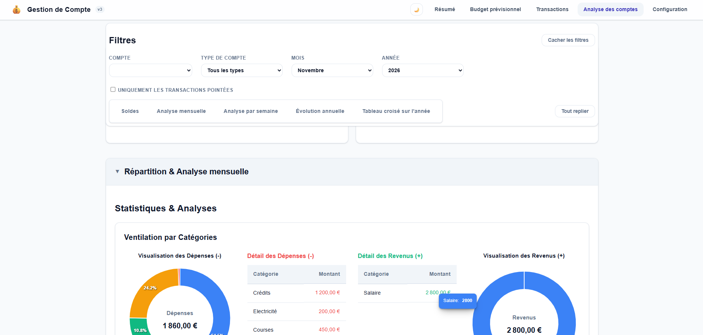
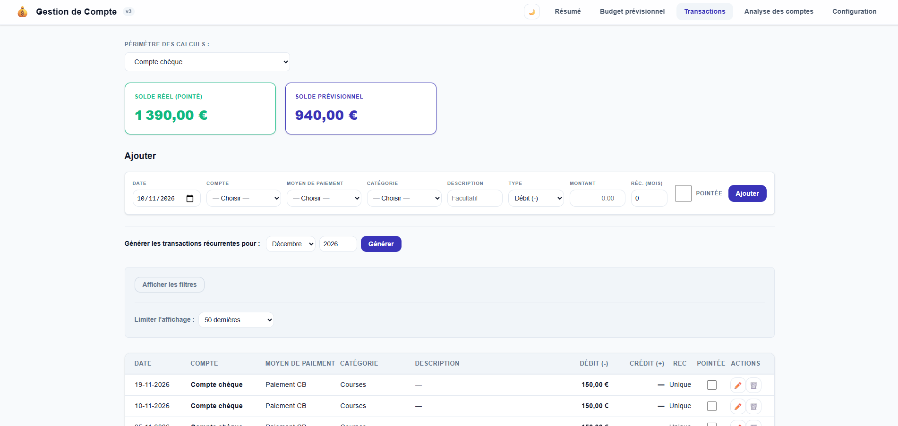
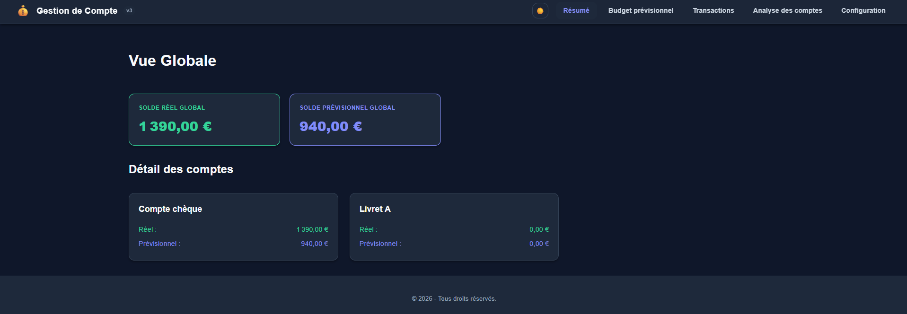

# Application de gestion de budget

Application web complète de suivi de budget personnel : comptes, transactions, budgets prévisionnels et tableaux de bord. Vous êtes sur la **troisième version** du projet.

Ce projet a été pensé et développé de zéro. Il m'a permis de remettre à jour mes connaissances sur TypeScript / Angular (version 19) et surtout de monter en compétence sur Java et Spring Boot.



<details>
<summary>Plus de captures d'écran</summary>





</details>

---

## Fonctionnalités

- **Comptes** (courant / épargne), **catégories** et **moyens de paiement**, avec archivage lorsqu'ils sont déjà utilisés.
- **Transactions** ponctuelles ou récurrentes, avec pointage.
- **Tableaux de bord** : soldes réel et prévisionnel, répartition par catégorie et par moyen de paiement, évolution annuelle, tableaux croisés.
- **Budget prévisionnel mensuel** _(nouveauté de la v3)_ : il peut être rempli en partie automatiquement grâce à une configuration rapide.

---

## Stack technique

| Couche          | Technologies                                        |
| --------------- | --------------------------------------------------- |
| Front-end       | Angular 19 (Signals), TypeScript                    |
| Back-end        | Java 21, Spring Boot 4, Spring Data JPA / Hibernate |
| Base de données | PostgreSQL 16                                       |
| Packaging       | Docker (build multi-étapes), Docker Compose         |
| Tests           | Vitest (front), JUnit (back)                        |

### Choix d'architecture

- **Front** : j'utilise les _Signals_ pour une détection des changements rapide et un code allégé. L'initialisation est faite dans `app.ts` avec un `forkJoin` pour que toutes les configurations soient chargées avant l'affichage.
- **Back** : la récupération des transactions filtrées utilise un `JOIN FETCH` pour éviter les requêtes supplémentaires (problème N+1).

---

## Lancement rapide

### Méthode 1 : Docker (recommandée)

Cette méthode construit l'application complète (Angular intégré au JAR Spring Boot) et lance PostgreSQL.

**Prérequis :** Docker Desktop lancé.

```bash
docker compose up --build
```

Puis ouvrez **http://localhost:9000**.

> **Premier lancement :** la base est vide. Commencez par créer un compte, une catégorie et un moyen de paiement dans l'onglet **Configuration**, puis ajoutez vos premières transactions.

### Méthode 2 : lancement local (sans Docker pour l'application)

**Prérequis :** Java 21, Maven et Node.js 22+.

1. **Base de données** (si vous n'avez pas de PostgreSQL local) :

   ```bash
   docker compose up postgres-db
   ```

   Identifiants par défaut : `postgres` / `admin`, base `gestionCompte` (à changer en dehors d'un usage de démonstration).

2. **Back-end** (port 9000) :

   ```bash
   cd apirest
   mvn spring-boot:run
   ```

3. **Front-end** (port 4200), dans un autre terminal :

   ```bash
   cd gestion-budget-front
   npm ci
   npm start
   ```

   Ouvrez **http://localhost:4200** : le front pointe automatiquement vers l'API locale.

---

## Tests

```bash
# Back-end
cd apirest && mvn test

# Front-end
cd gestion-budget-front && npm test
```

Chaque service et chaque composant est couvert par des tests unitaires. Ils ont été rédigés avec l'aide d'une IA, puis relus et vérifiés.

---

## Dépannage

- **Le port 5432 ou 9000 est déjà utilisé** : arrêtez le service concerné ou changez le port dans `docker-compose.yml`.
- **Repartir d'une base vide** (facultatif) : `docker compose down -v` supprime le volume de données.
